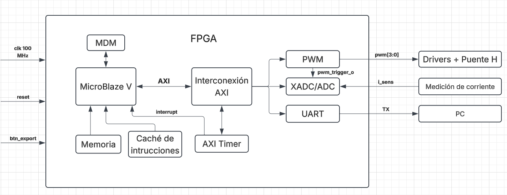

# Documento de Diseño — Proyecto 4

## Control de corriente en un inversor monofásico mediante un regulador PR discreto sobre MicroBlaze V

**Instituto Tecnológico de Costa Rica**  
**Escuela de Ingeniería Electrónica**  
**EL3313 — Taller de Diseño Digital**  
**II Semestre 2026**

**Equipo:** 06

### Integrantes

- Yerlin Angelitte Gamboa Ortiz — 2022184205
- Anthony Fabián Chacón Montero — 2022117452

---

## 1. Introducción

El proyecto consiste en el diseño e implementación de un sistema embebido en FPGA para controlar la corriente de un inversor monofásico mediante un regulador proporcional-resonante (PR) discreto.

La arquitectura utiliza el procesador MicroBlaze V, periféricos conectados mediante AXI4-Lite, adquisición de corriente mediante XADC, generación de PWM unipolar y comunicación UART.

El sistema digital se desarrolla en coordinación con el curso EL4201 — Procesamiento Electrónico de Potencia, integrando el procesamiento digital con la etapa de potencia del inversor.

## 2. Arquitectura del sistema digital

### 2.1. Diagrama de primer nivel

**Figura 1.** Arquitectura general del sistema digital implementado en FPGA.

### 2.2. Descripción del primer nivel

El diagrama representa la arquitectura general del sistema digital implementado en FPGA y las conexiones entre sus principales módulos.

El procesador MicroBlaze V constituye la unidad principal de procesamiento. Se encarga de ejecutar la aplicación de control y administrar los periféricos mediante la interconexión AXI4-Lite.

La memoria BRAM proporciona almacenamiento al procesador, mientras que la caché de instrucciones permite mejorar el acceso a las instrucciones. El módulo MDM proporciona la interfaz necesaria para realizar tareas de depuración del procesador.

El AXI Timer genera interrupciones periódicas que permiten establecer la frecuencia de ejecución del algoritmo de control PR. De esta manera, el procesador puede ejecutar las tareas de control de forma periódica.

El módulo PWM personalizado genera cuatro señales de conmutación destinadas a los drivers del puente H. Además, produce la señal interna `pwm_trigger_o`, utilizada para sincronizar el proceso de adquisición de corriente.

El XADC recibe la señal analógica acondicionada del sensor de corriente y realiza su conversión a datos digitales para que puedan ser procesados por MicroBlaze V.

Finalmente, el periférico UART permite transmitir hacia una computadora las muestras de corriente almacenadas. La solicitud de exportación se realiza mediante la entrada `btn_export`.

### 2.3. Entradas y salidas del sistema

#### 2.3.1. Interfaces externas

Las interfaces externas corresponden a las señales que ingresan o salen físicamente del FPGA para permitir la interacción con los elementos del sistema.

| Señal | Dirección | Función |
|---|---|---|
| `clk` | Entrada | Reloj de referencia de 100 MHz |
| `reset` | Entrada | Reinicio del sistema digital |
| `btn_export` | Entrada | Solicitud de transmisión de las muestras almacenadas |
| `i_sens` | Entrada | Señal analógica acondicionada del sensor de corriente |
| `pwm[3:0]` | Salida | Cuatro señales de control para los drivers del puente H |
| `TX` | Salida | Transmisión serial de datos hacia la computadora |

#### 2.3.2. Señales internas

Las señales internas permiten la comunicación y sincronización entre los módulos que conforman la arquitectura digital.

| Señal | Origen | Destino | Función |
|---|---|---|---|
| `AXI4-Lite` | MicroBlaze V | Interconexión AXI y periféricos | Comunicación y configuración de los periféricos |
| `interrupt` | AXI Timer | MicroBlaze V | Notificación de interrupciones periódicas |
| `pwm_trigger_o` | PWM | XADC | Sincronización de la adquisición de corriente |

La interconexión AXI4-Lite permite que MicroBlaze V acceda a los registros de los periféricos para realizar su configuración y controlar su funcionamiento.

La señal `pwm_trigger_o` establece la sincronización entre la generación de PWM y la adquisición de corriente, permitiendo coordinar ambos procesos dentro del sistema digital.

### 2.4. Funcionamiento general del sistema

El funcionamiento general comienza con la inicialización del procesador MicroBlaze V y la configuración de los periféricos conectados mediante AXI4-Lite.

Una vez iniciado el sistema, el AXI Timer genera interrupciones periódicas que permiten ejecutar el algoritmo de control PR. El módulo PWM produce las señales de conmutación necesarias para controlar los drivers del puente H.

Durante el funcionamiento, la señal `pwm_trigger_o` permite sincronizar la adquisición de corriente mediante el XADC. Las muestras obtenidas pueden ser procesadas por el sistema de control y almacenadas para su posterior consulta.

Cuando se activa la entrada `btn_export`, el sistema solicita la transmisión de las muestras almacenadas mediante UART hacia una computadora.

De esta manera, los diferentes módulos trabajan de forma coordinada para realizar la adquisición, procesamiento y generación de señales de control del inversor monofásico.

