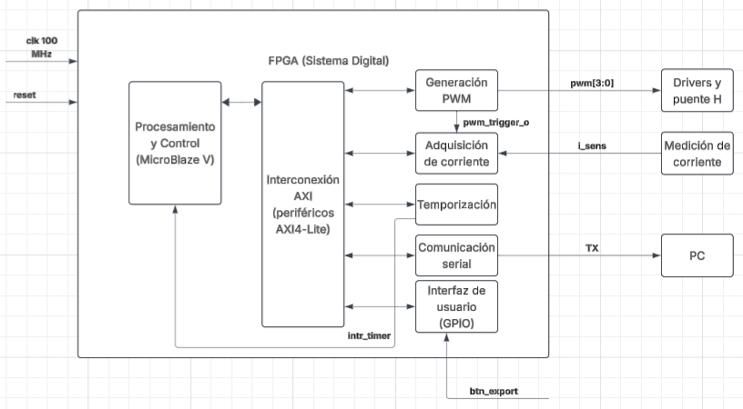
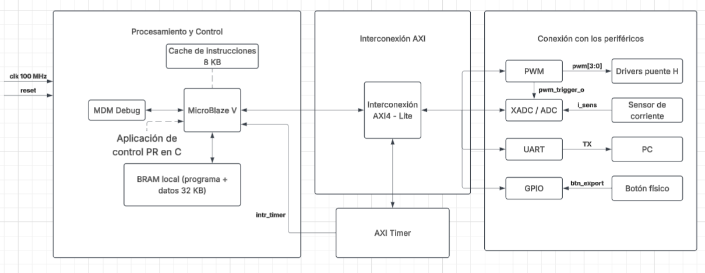
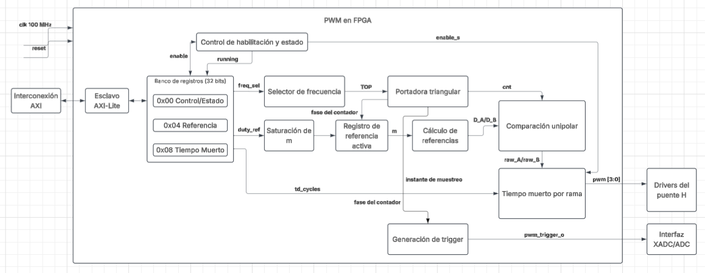

# Documento de Diseño — Proyecto 4

## Control de corriente en un inversor monofásico mediante un regulador PR discreto sobre MicroBlaze V

**Instituto Tecnológico de Costa Rica**  
**Escuela de Ingeniería Electrónica**  
**EL3313 — Taller de Diseño Digital**  
**II Semestre 2026**  
**Equipo:** 06

### Integrantes

- Yerlin Angelitte Gamboa Ortiz — 2022184205
- Anthony Fabián Chacón Montero — 2022117452

---

## 1. Introducción

El proyecto consiste en el diseño e implementación de un sistema embebido en FPGA para controlar la corriente de un inversor monofásico mediante un regulador proporcional-resonante (PR) discreto.

La arquitectura utiliza el procesador MicroBlaze V, periféricos conectados mediante AXI4-Lite, adquisición de corriente mediante XADC, generación de PWM unipolar con tiempo muerto configurable y comunicación UART.

El sistema digital se desarrolla en coordinación con el curso EL4201 — Procesamiento Electrónico de Potencia, integrando el procesamiento digital con la etapa de potencia del inversor.

---

## 2. Arquitectura del sistema digital

### 2.1. Diagrama de primer nivel

**Figura 1.** Diagrama general del sistema digital de control del inversor monofásico.

#### 2.1.1. Descripción del primer nivel

El primer nivel representa el sistema digital implementado en FPGA como un único bloque funcional, mostrando únicamente sus entradas y salidas externas.

El sistema recibe una señal de reloj de 100 MHz, una entrada de reinicio, la señal analógica acondicionada del sensor de corriente y una solicitud de exportación de muestras.

Como salidas, genera cuatro señales PWM destinadas a los drivers del puente H y una señal de transmisión UART para enviar información hacia una computadora.

#### 2.1.2. Entradas y salidas externas

| Señal | Dirección | Función |
|---|---|---|
| `clk` | Entrada | Reloj de referencia de 100 MHz |
| `reset` | Entrada | Reinicio del sistema digital |
| `i_sens` | Entrada | Señal analógica acondicionada del sensor de corriente |
| `btn_export` | Entrada | Solicitud de transmisión de las muestras almacenadas |
| `pwm[3:0]` | Salida | Cuatro señales de control para los drivers del puente H |
| `TX` | Salida | Transmisión serial de datos hacia la computadora |

### 2.2. Diagrama de segundo nivel

**Figura 2.** Descomposición del sistema digital en módulos funcionales.

#### 2.2.1. Descripción del segundo nivel

El segundo nivel presenta la arquitectura del sistema digital dividida en módulos funcionales, indicando sus conexiones principales y la forma en que intercambian información.

El módulo de Procesamiento y Control utiliza MicroBlaze V para ejecutar el algoritmo PR y administrar los periféricos mediante la interconexión AXI4-Lite.

El módulo de Generación PWM produce las señales de conmutación destinadas al puente H y genera la señal `pwm_trigger_o` para sincronizar la adquisición de corriente.

El módulo de Adquisición de corriente recibe la señal analógica acondicionada del sensor y permite obtener las muestras digitales para el procesamiento.

El módulo de Temporización utiliza AXI Timer para generar la interrupción periódica `intr_timer`, que establece la base temporal del controlador PR.

El módulo de Comunicación serial utiliza UART para transmitir las muestras almacenadas hacia una computadora. Por su parte, la Interfaz de usuario emplea GPIO para recibir la solicitud de exportación mediante `btn_export`.

#### 2.2.2. Módulos principales

| Módulo | Función principal |
|---|---|
| Procesamiento y Control | Ejecutar el controlador PR y administrar los periféricos mediante MicroBlaze V |
| Interconexión AXI | Permitir la comunicación entre el procesador y los periféricos |
| Generación PWM | Generar la modulación unipolar con tiempo muerto configurable |
| Adquisición de corriente | Convertir la señal analógica de corriente en datos digitales |
| Temporización | Generar interrupciones periódicas para la ejecución del controlador |
| Comunicación serial | Transmitir las muestras almacenadas hacia la computadora |
| Interfaz de usuario | Recibir la solicitud de exportación mediante un botón físico |

Las señales de reloj y reinicio se distribuyen internamente a los módulos que las requieren.

### 2.3. Diagrama de tercer nivel — Procesamiento, AXI y temporización

**Figura 3.** Arquitectura interna de procesamiento, interconexión AXI y temporización.

#### 2.3.1. Descripción del tercer nivel 

El tercer nivel presenta los componentes principales de la plataforma de procesamiento y las conexiones necesarias para integrar los periféricos del sistema digital.

El procesador MicroBlaze V constituye la unidad principal de procesamiento. Ejecuta la aplicación de control PR desarrollada en lenguaje C y realiza las operaciones de lectura y escritura sobre los periféricos.

La plataforma incluye una memoria BRAM local de 32 KB para almacenar instrucciones y datos, además de una caché de instrucciones de 8 KB que mejora el acceso a las instrucciones durante la ejecución.

El módulo MDM permite realizar tareas de depuración durante el desarrollo y las pruebas del sistema.

La interconexión AXI4-Lite proporciona comunicación entre MicroBlaze V y los periféricos PWM, XADC/ADC, UART, GPIO y AXI Timer.

El AXI Timer recibe su configuración mediante AXI y genera la señal `intr_timer`, utilizada para notificar al procesador cuándo debe ejecutar la rutina periódica del controlador.

El PWM se comunica con la interfaz de adquisición mediante `pwm_trigger_o`, permitiendo coordinar la generación de las señales de conmutación con la medición de corriente.

#### 2.3.2. Componentes de la plataforma

| Componente | Función |
|---|---|
| MicroBlaze V | Ejecutar la aplicación de control y administrar los periféricos |
| Caché de instrucciones | Mejorar el acceso a instrucciones, con capacidad de 8 KB |
| BRAM local | Almacenar programa y datos, con capacidad de 32 KB |
| MDM Debug | Permitir depuración y diagnóstico del procesador |
| Interconexión AXI4-Lite | Comunicar el procesador con los periféricos |
| AXI Timer | Generar interrupciones periódicas |
| PWM | Producir las señales de conmutación |
| XADC/ADC | Realizar la adquisición de corriente |
| UART | Transmitir información hacia la computadora |
| GPIO | Recibir señales de entrada del usuario |

#### 2.3.3. Temporización del controlador

La ejecución periódica del controlador PR se establece mediante AXI Timer.

El procesador configura el temporizador utilizando AXI4-Lite. Cuando se cumple el intervalo programado, el temporizador genera la interrupción `intr_timer`.

La aplicación en C atiende esta interrupción para gestionar la adquisición, calcular la acción de control y actualizar la referencia de modulación del PWM.

El período de ejecución del controlador deberá definirse en coordinación con la frecuencia de conmutación y la adquisición de corriente.

### 2.4. Diagrama de tercer nivel — PWM personalizado

**Figura 4.** Arquitectura funcional del periférico PWM personalizado con interfaz AXI4-Lite.

#### 2.4.1. Descripción del tercer nivel

El tercer nivel representa la organización interna propuesta del periférico PWM personalizado, que será desarrollado en SystemVerilog.

El módulo utiliza una interfaz esclava AXI4-Lite para recibir configuraciones desde MicroBlaze V y permitir la lectura de sus registros de estado.

El banco de registros almacena los parámetros de habilitación, selección de frecuencia, referencia de modulación y tiempo muerto.

El selector de frecuencia determina el período de la portadora triangular, permitiendo seleccionar al menos tres frecuencias de conmutación válidas.

La referencia de modulación recibida mediante AXI se limita al rango permitido y posteriormente se almacena en un registro de referencia activa.

Este registro permite aplicar la nueva referencia en un instante definido del período PWM, evitando modificaciones inesperadas durante la conmutación.

El bloque de cálculo de referencias obtiene las referencias correspondientes a las ramas A y B del puente H.

Ambas referencias se comparan con una portadora triangular común para producir las señales preliminares de modulación unipolar.

Posteriormente, la lógica de tiempo muerto por rama genera cuatro señales de salida, impidiendo el encendido simultáneo de los interruptores superior e inferior de una misma rama.

Finalmente, el módulo de generación de trigger utiliza la fase del contador de la portadora para producir `pwm_trigger_o`, utilizada por la interfaz XADC/ADC para sincronizar la adquisición de corriente.

#### 2.4.2. Componentes internos del PWM

| Componente | Función |
|---|---|
| Esclavo AXI4-Lite | Gestionar lecturas y escrituras desde MicroBlaze V |
| Banco de registros | Almacenar parámetros de configuración y estado |
| Control de habilitación y estado | Gestionar `enable`, `enable_s` y `running` |
| Selector de frecuencia | Seleccionar al menos tres frecuencias de conmutación |
| Portadora triangular | Generar la referencia temporal de comparación |
| Saturación de m | Limitar la referencia de modulación al rango admisible |
| Registro de referencia activa | Aplicar la referencia de manera sincronizada |
| Cálculo de referencias | Generar las referencias para las ramas A y B |
| Comparación unipolar | Producir las señales preliminares de conmutación |
| Tiempo muerto por rama | Evitar conmutaciones simultáneas dentro de cada rama |
| Generación de trigger | Producir la señal de sincronización del XADC |

#### 2.4.3. Modulación PWM unipolar

Para una referencia normalizada de modulación `m`, limitada al intervalo:

\[
-1 \leq m \leq 1
\]

Las referencias de las dos ramas del puente H se calculan como:

\[
D_A = \frac{1+m}{2}
\]

\[
D_B = \frac{1-m}{2}
\]

Estas referencias se comparan contra una portadora triangular común.

La comparación genera dos señales preliminares que posteriormente se procesan mediante la lógica de tiempo muerto para obtener las cuatro salidas complementarias destinadas a los drivers del puente H.

Cuando `enable_s` está desactivada, las cuatro salidas deben permanecer en estado de apagado.

#### 2.4.4. Banco de registros AXI4-Lite

El periférico utiliza los registros de control y referencia especificados en el enunciado. Se propone agregar un registro para configurar el tiempo muerto.

| Offset | Registro | Función |
|---|---|---|
| `0x00` | Control/Estado | Habilitación, selección de frecuencia y estado de funcionamiento |
| `0x04` | Referencia | Valor de referencia de modulación |
| `0x08` | Tiempo muerto | Configuración propuesta del tiempo muerto |

**Registro 0x00 — Control/Estado**

| Bits | Campo | Acceso | Función |
|---|---|---|---|
| `[0]` | `enable` | R/W | Habilita la generación PWM |
| `[2:1]` | `freq_sel` | R/W | Selecciona la frecuencia de conmutación |
| `[3]` | `running` | RO | Indica el estado de operación del generador |

**Registro 0x04 — Referencia**

| Bits | Campo | Acceso | Función |
|---|---|---|---|
| `[15:0]` | `duty_ref` | R/W | Referencia de modulación |

La referencia deberá representarse mediante un formato numérico definido durante la implementación y saturarse al rango admisible.

**Registro 0x08 — Tiempo muerto propuesto**

Este registro constituye una extensión de diseño para permitir la configuración del tiempo muerto mediante software.

Su formato y límites deberán definirse según la frecuencia del reloj, la resolución temporal y las necesidades de los drivers utilizados.

#### 2.4.5. Sincronización de la referencia y adquisición

La sincronización se realiza utilizando eventos asociados al contador de la portadora triangular.

Se consideran dos eventos principales:

- `period_start`: indica el inicio de un período PWM y permite actualizar el registro de referencia activa.
- `sample_event`: representa el instante de muestreo seleccionado y permite generar `pwm_trigger_o`.

Ambos eventos se derivan de la portadora, pero no necesariamente deben ocurrir en el mismo instante.

La posición del evento de muestreo deberá seleccionarse de acuerdo con las características de la etapa de potencia y la adquisición de corriente.

#### 2.4.6. Señales principales del PWM

| Señal | Dirección | Función |
|---|---|---|
| `clk` | Entrada | Reloj del sistema de 100 MHz |
| `reset` | Entrada | Reinicio del periférico |
| `AXI4-Lite` | Bidireccional | Interfaz de configuración y lectura |
| `enable` | Interna | Solicitud de habilitación |
| `enable_s` | Interna | Habilitación efectiva del generador |
| `running` | Interna | Estado de operación del PWM |
| `freq_sel` | Interna | Selección de frecuencia |
| `duty_ref` | Interna | Referencia recibida desde MicroBlaze V |
| `td_cycles` | Interna | Tiempo muerto expresado en ciclos de reloj |
| `period_start` | Interna | Evento de actualización sincronizada |
| `sample_event` | Interna | Evento de adquisición de corriente |
| `pwm[3:0]` | Salida | Cuatro señales de conmutación |
| `pwm_trigger_o` | Salida | Sincronización con el sistema XADC |

---

### Exportación de muestras por UART

*Figura 5. Diagrama de tercer nivel de exportación de muestras por UART.*

#### Descripción del tercer nivel

Este diagrama presenta la solicitud de exportación, la lectura del histórico de corriente y su transmisión hacia la computadora mediante UART.

El botón físico entrega su estado al GPIO. El programa detecta una pulsación válida y genera una solicitud de exportación. La detección del evento debe incluir antirrebote para evitar solicitudes repetidas por una misma pulsación.

El buffer circular conserva las muestras registradas durante la ejecución del control. Los punteros identifican la posición de escritura y permiten recuperar el histórico en orden cronológico. Al aceptar una exportación, se conserva el segmento seleccionado para evitar que sus datos cambien durante la transmisión.

El formateo organiza las muestras según el formato de comunicación acordado. El driver UART en C entrega los bytes al periférico AXI UART Lite mediante AXI4-Lite. Finalmente, UART Lite genera la señal TX hacia la computadora.

La transmisión se realiza fuera de la rutina periódica del controlador y permite que esta continúe ejecutándose.

#### Componentes y funciones

| Componente | Función |
|---|---|
| Botón físico | Permitir al usuario solicitar una exportación. |
| GPIO | Proporcionar al software el estado del botón. |
| Detección de evento | Identificar una pulsación válida mediante antirrebote y detección de cambio. |
| Solicitud de exportación | Coordinar la conservación y el envío del histórico. |
| Buffer circular | Almacenar las muestras recientes de corriente. |
| Punteros | Identificar las posiciones y la cantidad de muestras disponibles. |
| Lectura del histórico | Recuperar las muestras seleccionadas en orden cronológico. |
| Formateo de muestras | Organizar los datos para su transmisión e interpretación en la PC. |
| Driver UART en C | Administrar el envío por pasos sin impedir la ejecución del control periódico. |
| Interconexión AXI4-Lite | Comunicar el procesador con los registros del periférico UART. |
| AXI UART Lite | Convertir los bytes del software en una transmisión serial. |

#### Entradas y salidas

| Señal o interfaz | Tipo | Función |
|---|---|---|
| Reloj de 100 MHz | Entrada de reloj | Sincronizar el hardware de la plataforma. |
| Reset | Entrada de control | Inicializar los periféricos y el estado del sistema. |
| `btn_export` | Entrada del usuario | Solicitar la exportación del histórico. |
| Muestras de corriente | Entrada de datos | Alimentar el buffer desde la rutina de control. |
| Solicitud de exportación | Control interno | Iniciar la preparación de una captura. |
| Histórico y punteros | Datos internos | Identificar las muestras que deben transmitirse y su orden. |
| Muestras formateadas | Datos internos | Entregar al driver los bytes preparados para el envío. |
| AXI4-Lite | Entrada / salida | Transportar accesos a los registros de UART Lite. |
| TX hacia PC | Salida serial | Enviar el histórico a la computadora. |

#### Funcionamiento conjunto

Durante la operación, la rutina de control registra muestras en el buffer circular. Una pulsación válida solicita conservar el histórico y preparar su exportación.

El software utiliza los punteros para recorrer las muestras en orden cronológico, las formatea y las transmite por UART. Durante el envío, la captura seleccionada permanece estable y el control periódico continúa atendiendo la medición y la actualización del PWM.

### Adquisición de corriente mediante XADC

*Figura 6. Diagrama de tercer nivel de adquisición de corriente mediante XADC.*

#### Descripción del tercer nivel

Este diagrama presenta el recorrido de la medición desde el sensor de corriente hasta el programa ejecutado en MicroBlaze V.

El sensor genera una señal analógica representativa de la corriente de la carga. El acondicionamiento adapta su amplitud y desplazamiento al intervalo admitido por el XADC.

El PWM proporciona `pwm_trigger_o` para coordinar el instante de adquisición con la conmutación. El bloque de sincronización recibe este disparo y entrega la solicitud al control de conversión.

El control administra el inicio de la captura mediante `start_conversion` y supervisa la disponibilidad del convertidor. Cuando el XADC entrega un resultado válido, la muestra se almacena en el registro de datos y se actualiza el registro de estado.

MicroBlaze V consulta los registros mediante AXI4-Lite. La aplicación en C obtiene la muestra y utiliza la calibración de la cadena de medida para interpretarla como corriente.

#### Componentes y funciones

| Componente | Función |
|---|---|
| Sensor de corriente | Generar una señal analógica representativa de la corriente de la carga. |
| Acondicionamiento | Adaptar la señal del sensor a la entrada del XADC. |
| PWM | Proporcionar el disparo que establece el instante de adquisición. |
| Sincronización del disparo | Entregar una solicitud de captura compatible con el reloj de adquisición. |
| Control de conversión | Administrar la captura y la actualización de los registros. |
| XADC | Convertir la tensión acondicionada en una muestra digital de 12 bits. |
| Registro de datos | Conservar el resultado para su lectura desde el procesador. |
| Registro de estado | Informar la disponibilidad de la muestra y la ocupación de la adquisición. |
| Interfaz AXI4-Lite | Permitir el acceso del procesador a los registros. |
| MicroBlaze V y lectura en C | Recuperar la medición e incorporarla al programa de control. |

#### Entradas y salidas

| Señal o interfaz | Tipo | Función |
|---|---|---|
| Reloj de 100 MHz | Entrada de reloj | Sincronizar la lógica digital de adquisición. |
| Reset | Entrada de control | Inicializar el control y los registros. |
| Corriente de la carga | Entrada física | Magnitud que debe medirse. |
| `I_sens` | Señal analógica interna | Entregar la medición del sensor al acondicionamiento. |
| Tensión acondicionada | Señal analógica | Proporcionar al XADC una entrada compatible con su intervalo de operación. |
| `pwm_trigger_o` | Entrada de control | Solicitar una captura coordinada con el PWM. |
| `start_conversion` | Control interno | Iniciar la conversión. |
| Muestra digital | Datos internos | Transferir el resultado del XADC al registro de datos. |
| `data_ready` | Estado de salida | Indicar que existe una muestra disponible para lectura. |
| `busy` | Estado interno y de salida | Indicar que la adquisición está ocupada. |
| AXI4-Lite | Entrada / salida | Transportar solicitudes de acceso, datos y respuestas entre adquisición y procesador. |

#### Funcionamiento conjunto

El sensor y el acondicionamiento proporcionan la señal analógica que representa la corriente de la carga. El disparo del PWM solicita una adquisición y el control inicia la conversión cuando puede atenderla.

Al finalizar, la lógica guarda la muestra y actualiza los indicadores de estado. El programa consulta `data_ready`, lee el resultado y realiza el reconocimiento previsto por la interfaz.

La fase de adquisición debe coordinarse con la ejecución del controlador para que el software disponga de la muestra correspondiente a cada actualización del control.

### Software de control de corriente y actualización del PWM

*Figura 7. Diagrama de tercer nivel del software de control de corriente y actualización del PWM.*

#### Descripción del tercer nivel

Este diagrama presenta la inicialización de la aplicación, la rutina periódica del controlador y el almacenamiento de las mediciones.

Durante la inicialización, el programa configura PWM, XADC, UART, GPIO y AXI Timer. También establece los parámetros iniciales, los estados del controlador y los índices del buffer circular.

La interrupción periódica del Timer solicita la ejecución de la rutina de control. El programa verifica `data_ready` y obtiene una muestra válida de corriente desde la interfaz de adquisición.

La referencia sinusoidal `i_ref` se compara con la corriente medida `i_meas`. La diferencia forma el error `e = i_ref − i_meas`, utilizado por el controlador proporcional-resonante discreto para calcular la acción de control.

El resultado pasa por una etapa de saturación y limitación antes de convertirse al formato de `duty_ref` y escribirse en el registro del PWM. La muestra de corriente también se guarda en el buffer circular y se actualiza su índice cuando el registro del histórico está habilitado.

La aplicación se desarrolla en C y se ejecuta sobre MicroBlaze V. Vitis se utiliza para construir y depurar el programa.

#### Componentes y funciones

| Componente | Función |
|---|---|
| Configuración de periféricos | Preparar PWM, XADC, UART, GPIO y Timer para la operación. |
| Parámetros iniciales | Establecer referencia, coeficientes, estados del controlador e índices del histórico. |
| Atención de interrupción | Ejecutar la rutina periódica y reconocer la solicitud del Timer. |
| Verificación de `data_ready` | Comprobar la disponibilidad de una muestra válida. |
| Lectura de corriente | Obtener e interpretar la medición del subsistema de adquisición. |
| Generador de referencia sinusoidal | Producir el valor de corriente deseado para el instante actual. |
| Cálculo del error | Obtener la diferencia entre referencia y medición. |
| Controlador PR discreto | Calcular la acción de control a partir del error y sus estados internos. |
| Saturación y limitación | Mantener la acción de control dentro de los límites definidos. |
| Escritura de `duty_ref` | Entregar la nueva referencia al periférico PWM. |
| Almacenamiento e índice | Registrar la corriente y actualizar la posición del buffer circular. |
| MicroBlaze V | Ejecutar la aplicación y realizar los accesos a los periféricos. |

#### Entradas y salidas

| Señal o interfaz | Tipo | Función |
|---|---|---|
| Reloj de 100 MHz | Entrada de la plataforma | Proporcionar la referencia temporal del procesador y los periféricos. |
| Reset | Entrada de control | Reiniciar la plataforma y provocar una nueva inicialización del programa. |
| `intr_timer` | Entrada de interrupción | Solicitar la ejecución periódica del controlador mediante la infraestructura de interrupciones. |
| `data_ready` | Entrada de estado | Informar que existe una muestra disponible. |
| Muestra de corriente | Entrada de datos | Proporcionar la medición utilizada por el controlador. |
| Parámetros del control | Datos de configuración | Definir amplitud de referencia, coeficientes y límites de operación. |
| `i_ref` | Dato interno | Representar la corriente deseada en el instante actual. |
| `e` | Dato interno | Representar la diferencia entre referencia y corriente medida. |
| `duty_ref` | Salida de control | Actualizar la referencia de modulación del PWM. |
| Muestra e índice del buffer | Salida de almacenamiento | Mantener el histórico disponible para su exportación. |

#### Funcionamiento conjunto

El programa inicializa los periféricos y espera las interrupciones periódicas del Timer. En cada ejecución prevista, comprueba la disponibilidad de la medición, obtiene la corriente y genera la referencia sinusoidal.

El error alimenta al controlador PR. Su salida se limita y se escribe en el PWM para actualizar la actuación sobre la etapa de potencia. La corriente medida se registra en el buffer cuando el almacenamiento está habilitado.

La rutina debe finalizar dentro del período de control, propuesto en 100 µs. La adquisición debe proporcionar una muestra válida antes de su lectura y la exportación UART debe permitir que las interrupciones continúen atendiéndose.

Los tres diagramas se relacionan mediante este recorrido: adquisición entrega la medición, el software calcula y actualiza el PWM, y el buffer conserva las muestras para enviarlas posteriormente a la computadora.

## 3. Funcionamiento general del sistema

El funcionamiento comienza con la inicialización de MicroBlaze V y la configuración de los periféricos conectados mediante AXI4-Lite.

Durante esta etapa se establecen los parámetros iniciales del controlador, la frecuencia de conmutación, la referencia PWM y la base temporal del AXI Timer.

Una vez habilitado el sistema, la generación PWM produce las señales de conmutación para los drivers del puente H.

El sistema de adquisición recibe la señal analógica acondicionada del sensor de corriente y realiza las conversiones correspondientes, utilizando la sincronización proporcionada por `pwm_trigger_o`.

El AXI Timer genera interrupciones periódicas para ejecutar el controlador PR. En cada ejecución, MicroBlaze V obtiene la medición disponible, calcula la acción de control y actualiza la referencia del periférico PWM.

La muestra de corriente también se almacena en un buffer de memoria para conservar un registro de las mediciones.

Cuando el usuario activa `btn_export`, el procesador solicita la transmisión de las muestras almacenadas mediante UART hacia una computadora.

La transmisión deberá realizarse sin interrumpir la ejecución periódica del controlador.

---

## 4. Consideraciones de implementación

La arquitectura presentada corresponde a la propuesta de diseño modular del sistema digital.

Durante la implementación deberán definirse y verificarse los siguientes parámetros:

| Parámetro | Consideración |
|---|---|
| Frecuencias PWM | Seleccionar y justificar al menos tres valores válidos |
| Referencia de modulación | Definir el formato numérico de `duty_ref` |
| Tiempo muerto | Determinar el valor y su representación en ciclos de reloj |
| Sincronización | Establecer los instantes de actualización y adquisición |
| Período de control | Coordinar AXI Timer con el PWM y el XADC |
| Mapa AXI | Asignar las direcciones base mediante Vivado |
| Seguridad de conmutación | Evitar encendidos simultáneos en una misma rama |
| Exportación UART | Evitar interferencias con la ejecución periódica |

Los valores definitivos deberán seleccionarse en coordinación con las especificaciones de la etapa de potencia.

