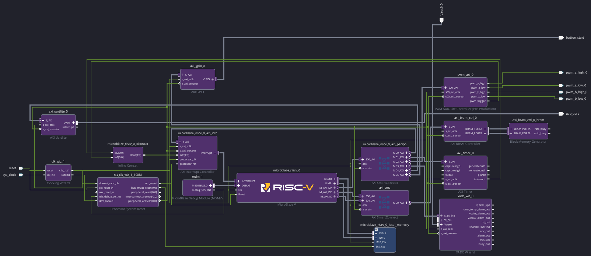
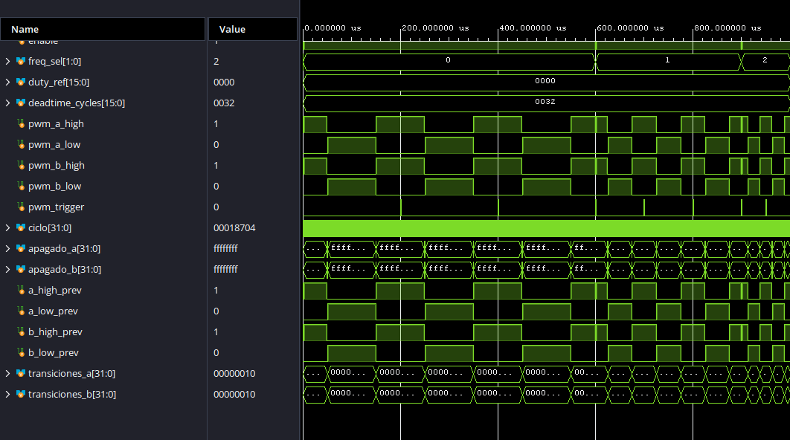
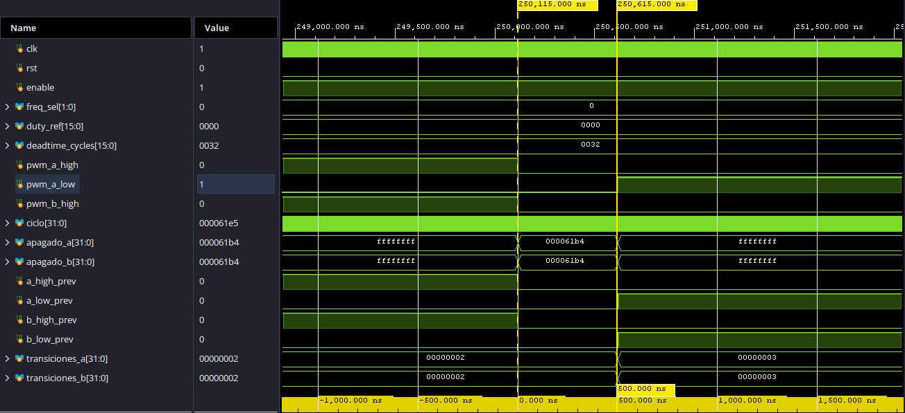
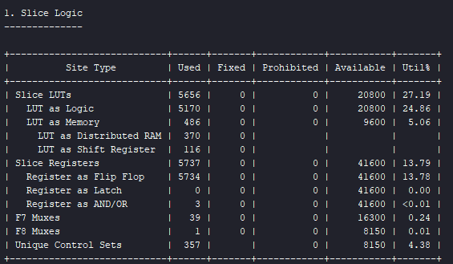
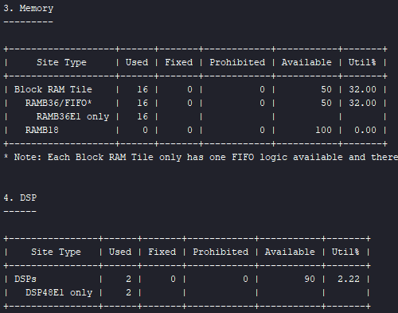
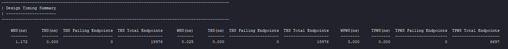
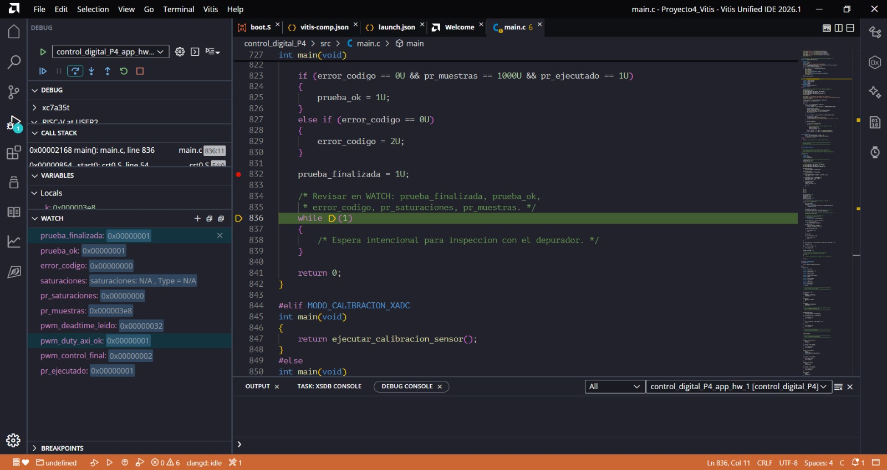

## Proyecto 4 — Control de corriente en un inversor monofásico mediante un regulador PR discreto sobre MicroBlaze V

## Informe

**Institución:** Instituto Tecnológico de Costa Rica  
**Escuela:** Ingeniería Electrónica  
**Curso:** EL3313 — Taller de Diseño Digital  
**Semestre:** II Semestre 2026  
**Equipo:** 06  

## Integrantes

| Nombre | Carné |
|---|---|
| Yerlin Angelitte Gamboa Ortiz | 2022184205 |
| Anthony Fabián Chacón Montero | 2022117452 |

## Profesores

- Dr.-Ing. Jeferson González-Gómez

---

## 1. Introducción

El control de corriente de un inversor necesita adquirir mediciones, procesarlas y actualizar señales de conmutación de forma periódica. Para desarrollar estas tareas se utilizó una FPGA Basys 3 con un procesador MicroBlaze V, periféricos implementados en hardware y una aplicación en C.

El sistema incluye un generador PWM unipolar, una interfaz AXI4-Lite para configurarlo, adquisición analógica mediante XADC y un regulador proporcional-resonante (PR) discreto. También se incorporaron un temporizador, un controlador de interrupciones y comunicación UART para realizar pruebas y observar resultados.

El trabajo se realizó por etapas. Primero se comprobaron los módulos de forma individual y después se avanzó en su comunicación e integración digital. Las pruebas disponibles permiten evaluar el PWM, el procesador y algunas funciones del regulador, pero **no demuestran todavía el control de una corriente real en lazo cerrado**, porque la integración con la etapa de potencia no pudo completarse.

## 2. Objetivos

### 2.1 Objetivo general

Desarrollar e implementar la parte digital de un sistema de control de corriente para un inversor monofásico, utilizando MicroBlaze V en la FPGA Basys 3 y periféricos personalizados para la generación PWM, la adquisición de señales y la comunicación con el software.

### 2.2 Objetivos específicos

- Diseñar un generador PWM unipolar en SystemVerilog con cuatro señales destinadas a las ramas del puente H.
- Incorporar un tiempo muerto configurable de 500 ns entre las salidas complementarias.
- Implementar una interfaz AXI4-Lite para configurar y supervisar el PWM desde MicroBlaze V.
- Integrar procesador, memorias y periféricos en el Block Design de Vivado.
- Preparar la adquisición de corriente mediante XADC y el sensor ACS712 de 20 A.
- Implementar el regulador PR discreto en C y verificar su comunicación con el registro DUTY.
- Comprobar mediante simulaciones y pruebas en FPGA el PWM, las comunicaciones y la base temporal de las interrupciones.

## 3. Fundamentos teóricos

### 3.1 MicroBlaze V e interfaces AXI4-Lite

MicroBlaze V es un procesador que puede implementarse dentro de una FPGA. En este proyecto ejecuta el programa en C, mientras que los periféricos realizan tareas como generar PWM, recibir señales analógicas o producir interrupciones.

La interfaz AXI4-Lite permite que el procesador lea o escriba registros asociados a direcciones de memoria. Por ejemplo, al escribir una nueva referencia en el registro DUTY, el software modifica el valor utilizado por el generador PWM sin necesidad de cambiar el código SystemVerilog.

### 3.2 PWM unipolar y tiempo muerto

La modulación por ancho de pulso, o PWM, modifica los intervalos de encendido y apagado para obtener una tensión promedio controlable. En el puente H se emplea modulación unipolar para las ramas A y B, con cuatro salidas: `pwm_a_high`, `pwm_a_low`, `pwm_b_high` y `pwm_b_low`.

El módulo utiliza una portadora y referencias de comparación para determinar las transiciones de las salidas. Se contemplaron frecuencias seleccionables de **5, 10 y 20 kHz**, utilizando un reloj de **100 MHz**.

El tiempo muerto evita que se activen simultáneamente las dos señales complementarias de una rama durante una transición. A 100 MHz cada ciclo dura 10 ns, por lo que:

> **Tiempo muerto = 500 ns / 10 ns = 50 ciclos.**

Esta medida se verificó a nivel digital. La comprobación con los drivers y transistores físicos sigue pendiente.

### 3.3 XADC y sensor ACS712

La Basys 3 incorpora un XADC que permite convertir señales analógicas en valores digitales. Para el proyecto se seleccionó el canal auxiliar **VAUX6**, previsto para recibir la señal acondicionada del sensor de corriente.

El sensor empleado es el **ACS712 de 20 A**, cuya sensibilidad nominal es de aproximadamente **0.100 V/A**. Su salida a corriente cero se encuentra aproximadamente a la mitad de la tensión de alimentación del sensor. Como la entrada unipolar del XADC tiene un rango nominal de 0 a 1 V, se requiere acondicionar la señal antes de conectarla.

Para un código ADC de 12 bits correctamente extraído, la relación ideal de conversión es:

> **V_ADC ≈ (N_ADC / 4096) · V_FS**

Donde `N_ADC` es el código del convertidor y `V_FS` la tensión de escala completa. Para calcular la corriente a partir de la salida original del sensor:

> **I_medida = (V_sensor − V_cero) / S**

Esta última expresión debe ajustarse para considerar la ganancia o atenuación del circuito de acondicionamiento. La calibración física completa de esa cadena de medición no quedó validada.

### 3.4 Regulador proporcional-resonante discreto

El regulador PR se utiliza para trabajar con señales sinusoidales, pues incorpora una acción resonante concentrada alrededor de una frecuencia determinada. Como referencia teórica, su forma ideal en tiempo continuo es:

> **G_PR(s) = Kp + (Kr · s) / (s² + ω₀²)**

En el proyecto se utiliza una referencia de **50 Hz**, de modo que:

> **ω₀ = 2π · 50 = 100π rad/s**

Para la implementación en MicroBlaze V se preparó un PR amortiguado y discreto. La frecuencia nominal de muestreo se estableció en **10 kHz**, equivalente a un período de **100 µs**.

De forma general, un regulador digital de segundo orden puede expresarse como:

> **u[k] = b₀e[k] + b₁e[k−1] + b₂e[k−2] − a₁u[k−1] − a₂u[k−2]**

Esta ecuación describe una estructura general; **no representa los coeficientes numéricos definitivos** del código desarrollado. El error de entrada se obtiene mediante:

> **e[k] = i_ref[k] − i_med[k]**

Durante las pruebas numéricas independientes se utilizó una corriente medida de prueba igual a cero, por lo que todavía no se evaluó el seguimiento de corriente real.

### 3.5 Temporización y comunicación UART

El AXI Timer y el controlador de interrupciones sirven para establecer una base temporal periódica, independiente del flujo normal del programa. La UART, configurada a **115200 baudios**, permite mostrar mensajes de diagnóstico y contempla la exportación de muestras almacenadas para analizarlas posteriormente.

## 4. Diseño e implementación de la solución digital

### 4.1 Arquitectura del sistema

El diseño se organizó alrededor de MicroBlaze V y su conexión con los periféricos mediante AXI. Los módulos principales son:

| Componente | Función |
|---|---|
| MicroBlaze V | Ejecutar el programa de control en C |
| Interconexión AXI | Comunicación del procesador con los periféricos |
| PWM personalizado | Generar cuatro señales PWM y `pwm_trigger` |
| XADC | Digitalizar la señal analógica de corriente |
| AXI Timer | Generar interrupciones periódicas |
| AXI Interrupt Controller | Gestionar eventos de interrupción |
| UART Lite | Transmitir información a la computadora |
| AXI GPIO | Manejar botones y señales de estado |

El reloj de referencia utilizado es de **100 MHz**. Las cuatro señales del PWM se asignaron a los pines PMOD JA de la Basys 3:

| Señal | Conector | Pin FPGA |
|---|---|---|
| `pwm_a_high` | JA1 | J1 |
| `pwm_a_low` | JA2 | L2 |
| `pwm_b_high` | JA3 | J2 |
| `pwm_b_low` | JA4 | G2 |

*Figura 1. Block Design completo del sistema digital, con MicroBlaze V, interconexión AXI, UART, GPIO, temporizador, PWM y XADC.*

*Figura 2. Detalle del Block Design donde se observan el periférico PWM AXI4-Lite, AXI Timer y XADC.*

### 4.2 Generador PWM personalizado

El módulo `pwm_unipolar.sv` fue desarrollado en SystemVerilog. Sus entradas principales son `clk`, `rst`, `enable`, `freq_sel`, `duty_ref` y `deadtime_cycles`; sus salidas incluyen las cuatro señales de conmutación y `pwm_trigger`.

El módulo utiliza contadores y comparaciones para decidir cuándo deben cambiar las salidas. La referencia de modulación modifica la conducción de las ramas A y B, mientras que la lógica de tiempo muerto mantiene ambas salidas de una rama apagadas durante el intervalo configurado.

Ante reset o deshabilitación, las salidas se llevan al estado apagado. La señal `pwm_trigger` se utiliza como referencia de sincronización para tareas digitales, aunque su coordinación completa con la adquisición real de corriente sigue pendiente.

### 4.3 Interfaz AXI4-Lite y mapa de registros

El PWM se integró con un esclavo AXI4-Lite para permitir lecturas y escrituras desde MicroBlaze V. Los offsets del periférico se muestran a continuación:

| Offset | Registro | Función |
|---|---|---|
| `0x00` | CONTROL | Habilitación, frecuencia y estado |
| `0x04` | DUTY | Referencia de modulación |
| `0x08` | DEADTIME | Tiempo muerto en ciclos de reloj |
| `0x0C` | STATUS | Consulta del estado del PWM |

En el registro CONTROL, el **bit 0** corresponde a `enable`, los **bits 2:1** a `freq_sel` y el **bit 3** al indicador `running` de solo lectura en la interfaz documentada. El registro DUTY emplea una referencia firmada de 16 bits; DEADTIME se configura con **50 ciclos**.

La dirección base depende de la versión integrada y debe tomarse del *Address Editor* o del archivo de configuración de la plataforma correspondiente. El mapa anterior presenta **offsets**, no direcciones absolutas.

### 4.4 Adquisición de corriente y acondicionamiento

Se configuró la entrada VAUX6 mediante XADC Wizard. El software contempla la lectura del valor digital, la corrección de corriente cero y el escalado necesario para utilizar la muestra en el regulador PR.

El circuito de acondicionamiento es indispensable porque la salida del ACS712 puede superar el rango admitido por el XADC. Aunque se preparó la ruta de adquisición, **no se obtuvo una calibración física definitiva** que permita afirmar que la lectura representa la corriente real con la precisión requerida.

**Figura pendiente:** esquema o fotografía del acondicionamiento del ACS712 de 20 A hacia VAUX6, con las conexiones y el rango de tensión señalados.

### 4.5 Aplicación en C y regulador PR

La aplicación de control se desarrolló en **Vitis 2026.1**. El código contempla inicialización de periféricos, generación de la referencia sinusoidal, adquisición XADC, cálculo del error, ejecución del PR y actualización del registro DUTY mediante AXI4-Lite.

Durante la programación se utilizaron diferentes modos para probar el controlador sin depender de la medición física. La aplicación `prueba_PR` permitió observar el comportamiento numérico; posteriormente se utilizaron pruebas PR–PWM para verificar la transferencia de valores hacia el periférico.

Los parámetros de control empleados en estas pruebas se consideran provisionales hasta su ajuste y validación frente a una planta real.

### 4.6 UART y almacenamiento de muestras

La UART se configuró a 115200 baudios. Se utilizó para comprobar la ejecución del procesador, transmitir mensajes de diagnóstico y observar resultados.

El programa también contempla almacenar muestras y enviarlas en formato CSV mediante una solicitud desde un botón físico. **La exportación completa mediante botón durante la ejecución periódica del control no quedó confirmada** con las evidencias de este informe.

## 5. Simulaciones, pruebas y resultados

### 5.1 Simulaciones autoverificables del PWM

Se elaboraron testbenches en SystemVerilog para comprobar las frecuencias seleccionables, la respuesta ante referencias positivas y negativas, la ausencia de solapamiento entre señales complementarias y el tiempo muerto de 50 ciclos. Las comprobaciones automáticas permiten emitir mensajes PASS o detener la simulación ante un error.

| Frecuencia | Ciclos a 100 MHz | Período esperado |
|---|---:|---:|
| 5 kHz | 20 000 | 200 µs |
| 10 kHz | 10 000 | 100 µs |
| 20 kHz | 5 000 | 50 µs |

En la versión documentada de las pruebas de Anthony se registraron mensajes **PASS** para las tres frecuencias, referencias con ambos signos, ausencia de solapamientos y un tiempo muerto de **500 ns**. El testbench AXI también permitió revisar operaciones de registros y la deshabilitación segura.

Estos resultados corresponden a pruebas digitales del módulo. La simulación **postimplementación temporizada con anotación SDF** y la cobertura final de casos límite deben documentarse por separado; no se consideran demostradas solo por haber ejecutado el testbench funcional.

*Figura 3. Simulación funcional de las cuatro salidas PWM con frecuencias seleccionables de 5, 10 y 20 kHz.*

*Figura 4. Verificación del tiempo muerto de 500 ns entre las señales complementarias del PWM.*

### 5.2 Síntesis, implementación y temporización

El proyecto pasó por las etapas de síntesis e implementación en Vivado y se obtuvo un bitstream de la versión documentada. Esto permitió programar la Basys 3 y continuar las pruebas del procesador y los periféricos.

Para evaluar los recursos y la temporización del diseño se revisaron los reportes de Vivado correspondientes a `sistema_control_digital_wrapper`, generados el 12 de noviembre de 2026. El reporte de utilización corresponde al diseño colocado (*Fully Placed*) y el de temporización al diseño enrutado (*Routed*).

| Recurso | Utilizado | Disponible | Utilización |
|---|---:|---:|---:|
| LUT | 5656 | 20800 | 27.19 % |
| Registros (FF) | 5737 | 41600 | 13.79 % |
| Block RAM | 16 | 50 | 32.00 % |
| DSP | 2 | 90 | 2.22 % |

*Figura 5. Utilización de LUT y registros del diseño digital.*

*Figura 6. Utilización de los recursos BRAM y DSP de la FPGA.*

El análisis de temporización posterior al enrutamiento proporcionó los siguientes resultados:

| Parámetro | Resultado |
|---|---:|
| Reloj principal | 100 MHz |
| WNS | +1.172 ns |
| TNS | 0.000 ns |
| WHS | +0.025 ns |
| THS | 0.000 ns |
| Rutas con fallos de setup | 0 |
| Rutas con fallos de hold | 0 |

El reporte indica que se cumplieron las restricciones de temporización especificadas. Sin embargo, también señala tres entradas y cinco salidas sin restricciones de retardo de E/S, por lo que no se debe interpretar el resultado como una validación completa de todas las interfaces externas.

*Figura 7. Resultados del análisis de temporización posterior al enrutamiento.*

El hecho de que Vivado genere el bitstream confirma un avance de implementación, pero **no sustituye las pruebas funcionales ni permite afirmar que el control completo cierre el lazo de corriente**.

### 5.3 MicroBlaze V, UART, GPIO y AXI Timer

Se realizaron pruebas para comprobar la ejecución del procesador y las comunicaciones básicas. Se observó transmisión por UART, manejo de GPIO y recepción de interrupciones del AXI Timer a través del controlador de interrupciones.

En una prueba de 10 000 interrupciones se registraron los siguientes valores:

| Parámetro | Resultado |
|---|---:|
| Reloj del sistema | 100 MHz |
| Período nominal | 100 µs |
| Interrupciones | 10 000 |
| Período mínimo | 9 998 ciclos |
| Período máximo | 10 002 ciclos |
| Conexión Timer–INTC | PASS |
| UART básica | PASS |

A 100 MHz, el rango registrado corresponde aproximadamente a **99.98–100.02 µs**. Estos resultados respaldan la base temporal en esa prueba, pero no miden por sí solos el tiempo de procesamiento del lazo completo.

Estos resultados se obtuvieron durante la prueba de interrupciones del AXI Timer. No se incorpora una captura de esa prueba entre las ocho evidencias gráficas disponibles.

### 5.4 Pruebas del controlador PR y del registro DUTY

Primero se ejecutó una prueba numérica independiente del PR. Posteriormente, en la aplicación `control_digital_P4`, se programaron **1000 iteraciones** durante las cuales el regulador calculaba una nueva salida y el procesador actualizaba el registro DUTY mediante AXI4-Lite. En esa prueba, el PWM permaneció deshabilitado.

| Variable observada | Resultado |
|---|---:|
| `prueba_ok` | 1 |
| `error_codigo` | 0 |
| `pr_ejecutado` | 1 |
| `pr_muestras` | 1000 |
| `pr_saturaciones` | 0 |
| `pwm_duty_axi_ok` | 1 |
| `pwm_deadtime_leido` | 50 |
| `pwm_control_final` | `0x00000002` |

La prueba terminó sin errores registrados, procesó las muestras previstas y comprobó las operaciones de lectura y escritura sobre DUTY. El registro DEADTIME devolvió 50 ciclos, mientras que la palabra de control final mantuvo el bit de habilitación desactivado.

*Figura 8. Resultados de las 1000 iteraciones del regulador PR y la comunicación AXI4-Lite.*

### 5.5 Prueba histórica sincronizada por `pwm_trigger`

Además de las 1000 iteraciones numéricas anteriores, Anthony documentó una **prueba digital independiente** que utilizó interrupciones relacionadas con `pwm_trigger`, una referencia virtual y la FPGA sin etapa de potencia conectada.

| Variable de esa prueba | Resultado |
|---|---:|
| Interrupciones PWM recibidas | 1000 |
| Muestras PR ejecutadas | 999 |
| Muestras perdidas | 0 |
| Retrasos contabilizados | 0 |
| Tiempo máximo de procesamiento observado | 4026 ciclos = 40.26 µs |
| Período disponible | 10 000 ciclos = 100 µs |

El resultado de 40.26 µs corresponde al bloque observado mediante software durante esa prueba corta, de aproximadamente 100 ms. **No significa que se haya medido toda la latencia desde la corriente física hasta las compuertas**, ni que se haya demostrado estabilidad a largo plazo o exportación UART simultánea.

Esta prueba sincronizada se documenta mediante los valores registrados en la tabla anterior. No se incorpora una captura adicional entre las ocho evidencias disponibles.

### 5.6 Alcance de las verificaciones de adquisición y exportación

El XADC y las rutinas de procesamiento de corriente forman parte del diseño. Sin embargo, no se dispone de una calibración completa del ACS712 de 20 A y del acondicionamiento que demuestre una medición de corriente válida durante el control integrado.

La UART básica fue comprobada, pero la exportación de muestras en CSV al presionar un botón, mientras se mantiene el control periódico, debe distinguirse de la simple transmisión de mensajes de diagnóstico.

## 6. Análisis y discusión de resultados

Las simulaciones y pruebas funcionales confirmaron avances importantes en el PWM: selección de frecuencias, respuesta a referencias de ambos signos, apagado seguro y tiempo muerto digital de 50 ciclos. El bus AXI4-Lite permitió separar el cálculo en C de la generación física de señales PWM, facilitando las pruebas por etapas.

La prueba del AXI Timer mostró interrupciones próximas a los 100 µs previstos. Además, la prueba histórica sincronizada de Anthony registró un bloque de procesamiento con duración máxima observada de 40.26 µs en las condiciones ensayadas. Sin embargo, se trató de una prueba corta con referencia virtual, no de una caracterización completa de todos los retardos del sistema integrado.

Por su parte, las 1000 iteraciones del ensayo PR–DUTY de Yerlin permitieron comprobar el funcionamiento numérico del algoritmo y las operaciones AXI, sin habilitar las salidas. Estos resultados **no deben mezclarse** con la prueba sincronizada, porque tuvieron condiciones y objetivos diferentes.

La síntesis, la implementación y el bitstream permiten confirmar que el diseño digital avanzó hasta una versión programable en FPGA. Los reportes del 12 de noviembre muestran una utilización de 27.19 % de LUT y 32.00 % de BRAM, además de márgenes positivos de setup y hold en las rutas analizadas. Aun así, se debe confirmar que estos reportes corresponden a la versión final declarada y completar la verificación de la interfaz ADC y las pruebas temporizadas postimplementación correspondientes.

## 7. Limitaciones y trabajo pendiente

La principal limitación fue que **no se completó la integración física entre la FPGA y la etapa de potencia**. Por lo tanto, no se realizaron pruebas concluyentes de seguimiento de corriente real ni se validó el comportamiento del regulador PR en lazo cerrado sobre el inversor.

También quedaron pendientes la calibración física del sensor ACS712 de 20 A con su acondicionamiento, la comprobación de adquisición sincronizada, la exportación completa por UART mientras opera el control, las pruebas de protección y la caracterización temporal del sistema completo.

Antes de las pruebas energizadas se deben verificar las cuatro señales PWM y el tiempo muerto en los pines físicos, con los drivers y la etapa de potencia en condiciones seguras y desenergizadas. Las evidencias digitales presentadas aquí no sustituyen esa comprobación.

## 8. Conclusiones y aprendizajes

El Proyecto 4 permitió desarrollar una plataforma digital basada en MicroBlaze V y un generador PWM unipolar personalizado para un inversor monofásico. Se implementó la interfaz AXI4-Lite, se configuró un tiempo muerto de 500 ns y se realizaron simulaciones y pruebas de funcionamiento de los periféricos.

Las pruebas de MicroBlaze V, UART, GPIO e interrupciones permitieron verificar componentes esenciales del sistema. En el software, la ejecución numérica del PR y la actualización del registro DUTY demostraron la comunicación entre el controlador desarrollado en C y el hardware personalizado.

Una de las principales lecciones fue la importancia de validar cada módulo antes de integrarlo con los demás. Las comprobaciones independientes permitieron corregir problemas de interrupciones y verificar comunicaciones sin depender de la etapa de potencia.

A pesar de estos avances, **no se considera validado el control de corriente completo**. Para llegar a ese punto será necesario integrar las mediciones reales del XADC, confirmar el tiempo de ejecución del lazo en condiciones definitivas y probar el inversor con las medidas de seguridad correspondientes.

## 9. Referencias

1. AMD, *Vitis Unified Software Platform Documentation* (UG1416).
2. AMD, *MicroBlaze V Embedded Design Tutorial* (UG1711).
3. AMD, *7 Series FPGAs and Zynq-7000 SoC XADC Dual 12-Bit 1 MSPS Analog-to-Digital Converter User Guide* (UG480).
4. Allegro MicroSystems, *ACS712 Fully Integrated, Hall-Effect-Based Linear Current Sensor IC Datasheet*.
5. AMD, *AXI Reference Guide* (UG1037).
6. Escuela de Ingeniería Electrónica, *Proyecto 4: Control de corriente en un inversor monofásico mediante un regulador PR discreto sobre MicroBlaze V*, II semestre de 2026.
7. Equipo del Proyecto 4, repositorio de código y evidencias digitales, Instituto Tecnológico de Costa Rica, 2026.
